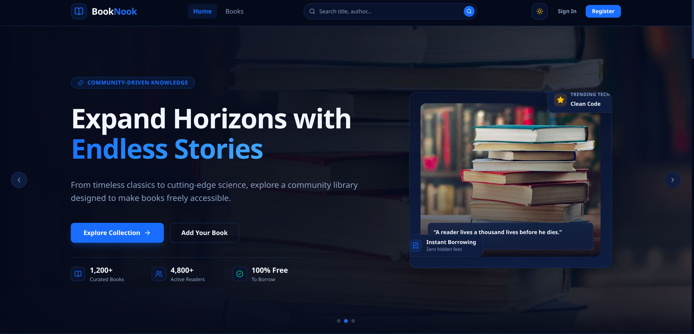

# 📚 BookNook Backend — REST API

<p align="center">
  
</p>

<p align="center">
  <strong>Powering the BookNook Online Library</strong>
</p>

<p align="center">
  <a href="https://book-nook-web.vercel.app/">Live Website</a> •
  <a href="https://github.com/shahidul91325/BookNook-Web">Frontend Repository</a> •
  <a href="https://github.com/shahidul91325/BookNook-Backend">Backend Repository</a>
</p>

## 📖 About

BookNook Backend is a RESTful API built with Express.js, TypeScript, and MongoDB. It powers the BookNook online library by handling book management, borrowing operations, inventory tracking, authentication, and secure API authorization.

The backend provides protected endpoints and user-specific data access to ensure that users can manage their own books and borrowing records securely.

## ✨ Features

- 📚 **Book Management:** Create, read, update, and delete books.
- 🔐 **JWT Authentication:** Verify JWT tokens for protected API operations.
- 👤 **User Authorization:** Identify users through verified JWT claims.
- 🔄 **Borrow System:** Borrow and return books.
- 📦 **Inventory Management:** Track total and available copies.
- 🚫 **Duplicate Borrow Prevention:** Prevent simultaneous duplicate borrowing of the same book by one user.
- 🔒 **Ownership Validation:** Protect user-specific book operations.
- ✅ **Request Validation:** Validate request bodies and MongoDB ObjectIds.
- 🗄️ **MongoDB Integration:** Store books and borrowing records.

## 🛠️ Tech Stack

| Technology  | Purpose                       |
| ----------- | ----------------------------- |
| Node.js     | Runtime environment           |
| Express.js  | REST API framework            |
| TypeScript  | Type safety                   |
| MongoDB     | Database                      |
| Better Auth | Authentication                |
| JWT         | API authorization             |
| Zod         | Request validation            |
| CORS        | Cross-origin request handling |

## 🔌 API Endpoints

### Books API

| Method | Endpoint     | Description            |
| ------ | ------------ | ---------------------- |
| GET    | `/api/books`     | Retrieve all books     |
| GET    | `/api/books/:id` | Retrieve a single book |
| POST   | `/api/books`     | Create a new book      |
| PATCH  | `/api/books/:id` | Update a book          |
| DELETE | `/api/books/:id` | Delete a book          |

### Borrows API

| Method | Endpoint       | Description                                  |
| ------ | -------------- | -------------------------------------------- |
| POST   | `/api/borrows`     | Borrow a book                                |
| GET    | `/api/borrows`     | Retrieve authenticated user's borrowed books |
| DELETE | `/api/borrows/:id` | Return a borrowed book                       |

**Authentication:** Protected endpoints require a valid JWT Bearer token.

## 🚀 Installation

### 1. Clone the repository

```bash
git clone https://github.com/shahidul91325/BookNook-Backend.git
cd BookNook-Backend
```

### 2. Install dependencies

```bash
npm install
```

### 3. Configure environment variables

Create a `.env` file:

```env
PORT=5000
NODE_ENV=development

MONGODB_URI=your_mongodb_connection_string
MONGODB_DB_NAME=booknook

BETTER_AUTH_SECRET=your_better_auth_secret
BETTER_AUTH_URL=http://localhost:3000/api/auth
JWT_JWKS_URL=http://localhost:5000/api/auth/jwks

GOOGLE_CLIENT_ID=your_google_client_id
GOOGLE_CLIENT_SECRET=your_google_client_secret
```

**Important:**

- Never commit `.env` files or expose private credentials.
- Use the correct frontend URL for `BETTER_AUTH_URL`.
- Configure the backend JWKS URL for JWT verification.
- Google OAuth credentials are needed when Google sign-in is enabled.
- Use production URLs and environment variables when deploying.

### 4. Run the development server

```bash
npm run dev
```

The backend runs at:

http://localhost:5000

### 5. Build the project

```bash
npm run build
```

## 🔐 Authentication & Security

- Better Auth handles authentication.
- JWT tokens authorize protected API requests.
- Tokens are verified using the configured JWKS endpoint.
- User identity is extracted from verified token claims.
- Client-provided user IDs and emails are not trusted for ownership.
- Protected operations enforce authentication and authorization.
- Request validation helps prevent invalid database operations.

## 🗄️ Database & Inventory

MongoDB stores book information and borrowing records.

The inventory system tracks:

- Total copies of each book.
- Available copies.
- Borrowing records.
- Borrow dates and return dates.

When a user borrows a book, available inventory decreases. When a book is returned, available inventory increases.

The API also prevents users from borrowing the same book multiple times simultaneously.

## 📁 Project Structure

```text
BookNook-Backend/
├── src/
│   ├── config/
│   ├── middleware/
│   ├── models/
│   ├── routes/
│   └── app.ts
├── package.json
├── tsconfig.json
└── README.md
```

## 🔗 Frontend Integration

The backend powers the BookNook Next.js frontend.

**Frontend Repository:**  
https://github.com/shahidul91325/BookNook-Web

**Live Website:**  
https://book-nook-web.vercel.app/

## 🌐 Deployment

The backend is designed to run as an Express.js API and can be deployed using platforms such as Vercel.

Configure all required production environment variables before deployment, including MongoDB, Better Auth, Google OAuth (if enabled), and JWT settings.

## 👨‍💻 Developer

**Md. Shahidul Islam**

- GitHub: https://github.com/shahidul91325
- LinkedIn: https://www.linkedin.com/in/shahidul91325/

---

<p align="center">
  Built with ❤️ using Express.js, TypeScript, MongoDB, and Better Auth.
</p>
